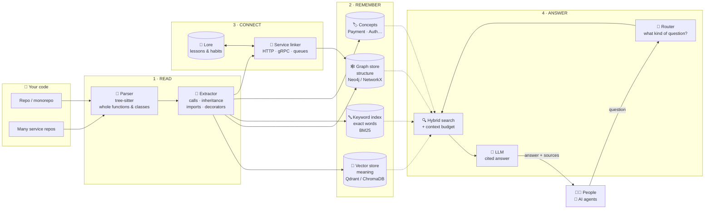
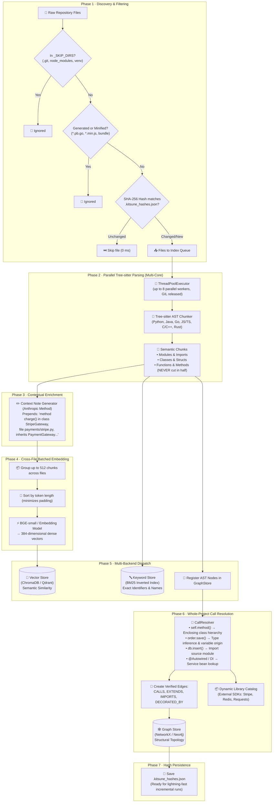
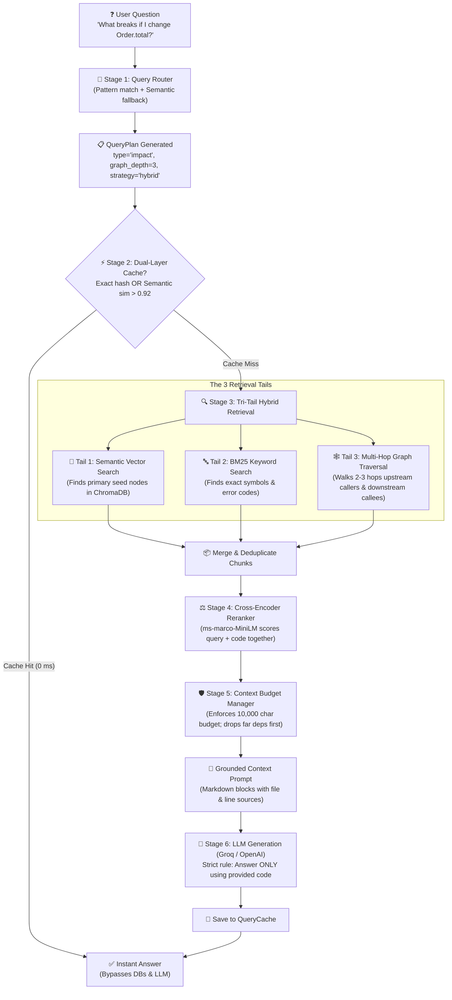
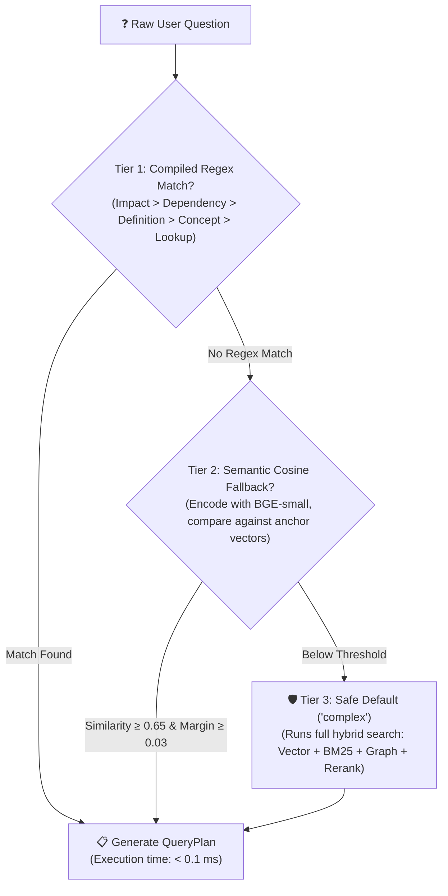
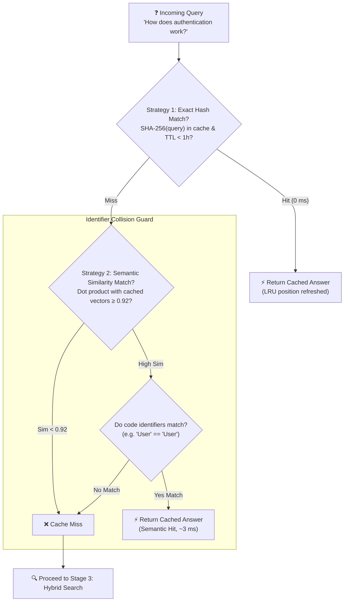
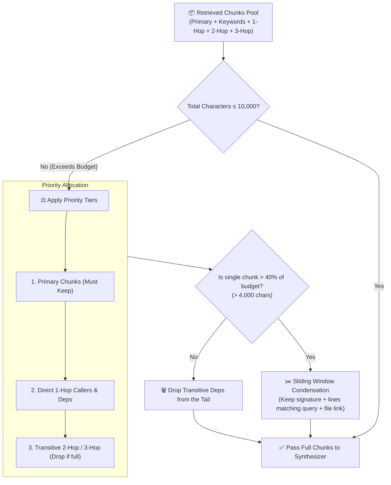
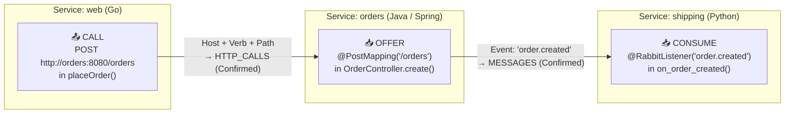
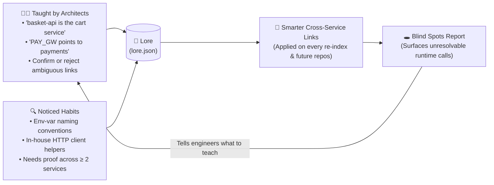

# 🦊 Kitsune — The Code Knowledge Engine

> **Kitsune reads a whole codebase, or a whole system of services, and builds a map of how
> everything connects. People and AI agents can then ask questions about the code and get
> answers that point to the exact code they come from.**

| | |
|---|---|
| **Who it is for** | Engineers, reviewers, architects and AI coding agents |
| **What it answers** | "Where is X?", "What calls X?", "What breaks if I change X?", "How does payment work?", "Which services depend on cart?" |
| **Where it runs** | A laptop (no setup), or shared servers for a team (Qdrant + Neo4j) |
| **Languages** | Python, Java, Go, JavaScript, TypeScript, C, C++, Rust; optionally Kotlin, C#, PHP |
| **Ways to use it** | Python API, the `kitsune` command line, or (experimental) AI agents via MCP |

**Contents:**
1. [Why the name Kitsune](#1-why-the-name-kitsune)
2. [The problem it solves](#2-the-problem-it-solves)
3. [Architecture at a glance](#3-architecture-at-a-glance)
4. [How Kitsune reads code](#4-how-kitsune-reads-code-indexing)
5. [How Kitsune answers](#5-how-kitsune-answers-a-question)
6. [Many services, one map](#6-many-services-one-map)
7. [Growing with age](#7-growing-with-age-the-lore)
8. [Where data lives and how it is deployed](#8-where-data-lives-and-how-it-is-deployed)
9. [Proven results](#9-proven-results)
10. [Honest limits and roadmap](#10-honest-limits-and-roadmap)
11. [Using it](#11-using-it)
12. [Glossary](#12-glossary)

---

## 1. Why the name Kitsune

In Japanese folklore a **kitsune** (狐) is a fox spirit. It is famous for its intelligence,
its many tails, its power to change shape, its eye for seeing through illusions, and its
role as a messenger between worlds. It grows wiser and gains tails with age.
Each of these traits is a real part of the engine:

| The fox spirit… | Kitsune the engine… |
|---|---|
| 🧠 **is intelligent**: it understands rather than memorises | Understands code **structure** (who calls whom, who inherits from whom), not just the words in the text |
| 🦊 **has many tails**, each a power | Has several search "tails" that work together: **meaning** (vector search), **structure** (graph), **exact words** (keyword search) and **services** (cross-service links) |
| 🔄 **changes shape** to fit any world | Fits any codebase: one repo or many, 8 languages, HTTP, gRPC or queues, a laptop or a server cluster |
| 👁️ **sees through illusions** | Works out what code *really* calls: `new ServiceUri("payment", …)` is the payment service; `getenv("CART_ENDPOINT", "cart")` is cart; `api.github.com` is *not* your catalogue service |
| 📜 **is a messenger between worlds** (the messenger of Inari) | Carries knowledge **between services**: it links a call in one repo to the code that handles it in another |
| ⏳ **grows wiser and gains tails with age** | Has a **lore**: it remembers lessons people teach it and habits it notices, and its *tails* grow as it learns ([section 7](#7-growing-with-age-the-lore)) |
| 🙇 **is honest about what it knows**, a trait of the wise fox | Marks a link **confirmed** only when sure. Otherwise it says **possible**, and it lists its **blind spots** |

---

## 2. The problem it solves

Nobody, human or AI, can hold a large codebase in their head. Ordinary "AI over code" tools
cut files into blocks of N lines and search them by similarity. That breaks in three ways:

| Ordinary approach | What goes wrong | What Kitsune does instead |
|---|---|---|
| Cuts files every N lines | A function is split in half and the AI guesses the rest | Cuts at **real boundaries**: whole functions, methods, classes |
| Searches text only | It finds `checkout()` but not the `charge()` it calls | Builds a **graph** of calls and inheritance, and follows it |
| Looks at one repo | It can't see that the Go gateway calls the Java orders service | **Links services** across repos by their HTTP, gRPC and queue contracts |

---

## 3. Architecture at a glance



**In one sentence each:**
1. **Read:** parse every file into meaningful pieces (*chunks*) and note what each piece calls.
2. **Remember:** store every chunk three ways: by meaning, by structure and by exact words.
3. **Connect:** find where services call each other and draw those links into the same graph.
4. **Answer:** classify the question, gather exactly the right code within a size limit, and let an LLM explain it with sources.

### Code map

```
kitsune/
├── engine/knowledge_engine.py   ← the single entry point (everything goes through here)
├── indexer.py                   ← READ: parallel, incremental indexing
├── parser/                      ← tree-sitter parsing, chunking, call extraction
├── embedder/                    ← meaning vectors (bge-small), context notes, reranker
├── store/                       ← vector, graph and keyword stores (server + local versions)
├── graph/                       ← call resolver, library catalog, traversal
├── services/                    ← CONNECT: discovery, contracts, linker, lore
├── query/                       ← ANSWER: router, hybrid search, cache, budget, synthesizer
├── concepts/                    ← business concepts (Payment, Auth…) with risk scores
├── agents/                      ← investigator (bug → root cause), planner (root cause → fix)
└── eval/ · tests/               ← quality evaluations and unit tests
```

---

## 4. How Kitsune reads code (indexing)

Kitsune does not treat code as plain text or split files into arbitrary 500-token chunks. Doing so ruins syntax, slices functions in half, and loses the caller-callee relationships that software engineers rely on.

Instead, Kitsune runs an **intelligent 7-phase indexing pipeline** orchestrated by `indexer.py`. It inspects your codebase, understands the Abstract Syntax Tree (AST), enriches code snippets with contextual breadcrumbs, embeds semantics in batches, resolves exact call targets, and stores everything across three complementary databases (**Vector Store**, **Graph Store**, and **Keyword Store**).



---

### Phase 1: File Discovery & Noise Sifting

**The Goal:** Discover all valid source files in the codebase while aggressively filtering out noise, autogenerated code, and bundled assets before wasting any CPU or embedding budget on them.

#### 💡 Context & Technical Concepts:
* **What is Minified Code (`.min.js`, `*.bundle.js`)?**
  When developers build web applications, tools like Webpack or Vite compress all JavaScript into a single, unreadable line (e.g. `function a(b,c){return b+c}`). Variables are renamed to single letters. Indexing minified files is completely useless because developers never ask questions about bundle artifacts, and it wastes massive database space.
* **What are Protobuf / gRPC Stubs?**
  Google's Protocol Buffers (`.proto`) compile into massive boilerplate files (`*.pb.go`, `*_pb2.py`, `Grpc.java`) containing thousands of lines of machine-generated serialization code. Indexing these creates immense noise in search results.
* **What is Garbage Collection of Deleted Files?**
  If a developer deletes or renames `old_auth.py` on disk, the index must not keep ghost references. Otherwise, the AI will recommend code from files that no longer exist!

#### How Kitsune Implements It:
1. **Directory Blacklist (`_SKIP_DIRS`):**
   Automatically ignores build caches and vendor dependencies: `.git`, `node_modules`, `venv`, `.venv`, `__pycache__`, `build`, `dist`, `vendor`, and hidden directories.
2. **Generated File Detection (`_is_generated`):**
   * Checks file extension patterns: `*.pb.go`, `*_pb2.py`, `*_grpc_pb.js`, `Grpc.java`, `*_generated.*`.
   * Inspects the **first 2,000 bytes** of the file for comment headers generated by tools:
     `"Code generated ... DO NOT EDIT"`, `"@generated"`, or `"Generated by protocol buffer compiler"`.
3. **Minified Bundle Detection (`_is_minified`):**
   Identifies `.min.js` and any file $> 100\text{ KB}$ whose average line length exceeds 300 characters (the universal sign of a bundled file).
4. **Deleted File Purging:**
   Compares the current disk scan against `.kitsune_hashes.json`. Any file present in the cache but missing from disk is immediately deleted from all three stores (Vector, BM25, and Graph).

---

### Phase 2: Incremental Change Detection (SHA-256 Fingerprinting)

**The Goal:** Ensure that re-indexing a repository of 100,000 lines finishes in **under 1 second** by only processing files that were actually modified.

#### 💡 Context & Technical Concepts:
* **Why Content Hash (SHA-256) instead of File Timestamps (`mtime`)?**
  Many build systems check the file's last modified timestamp (`mtime`). However, in Git, running `git checkout`, `git pull`, or switching branches updates the filesystem timestamp on hundreds of files **even if the code inside them didn't change at all**!
  A cryptographic content hash (SHA-256) inspects the *exact bytes* of the file. If the code didn't change, the hash is identical, regardless of the timestamp.
* **Store Synchronization Safety:**
  If a user deletes the local vector database folder (`./data/kitsune/chroma/`), but `.kitsune_hashes.json` still exists, a naive system would think all files are indexed and do nothing. Kitsune verifies that `vector_store.count() > 0`; if the database is empty, it automatically invalidates the hashes and triggers a clean re-index.

#### How Kitsune Implements It:
```python
file_hash = hashlib.sha256(file_bytes).hexdigest()[:16]
```
* **Unchanged File:** If `file_hash == existing_hashes[rel_path]`, the file is skipped in **0 ms**.
* **Changed / New File:** Added to the parsing queue.
* **Atomic Cache Save:** Hashes are saved to `.kitsune_hashes.json` only after every single chunk has been safely written to all databases. If indexing crashes mid-way, failed files are retried on the next run.

---

### Phase 3: Parallel Tree-sitter AST Parsing (Multi-Core)

**The Goal:** Parse source files into structured, syntactically whole code units (modules, classes, methods, functions) using native multi-core execution.

#### 💡 Context & Technical Concepts:
* **What is an AST (Abstract Syntax Tree)?**
  Compilers and linters do not see code as flat text. They convert code into a tree structure representing programming syntax:
  ```
  Program
   └── ClassDeclaration: "PaymentService"
        └── MethodDeclaration: "charge"
             ├── Parameters: [amount: int, currency: str]
             └── Block: [if currency not in ... return ...]
  ```
  Knowing the AST allows Kitsune to know exactly where a function begins and ends.
* **Why Naive Chunking Breaks Code:**
  Traditional RAG tools (like LangChain's `RecursiveCharacterTextSplitter`) split files every 500 characters or 50 lines. In code, this splits `for` loops, separates variable definitions from where they are used, and slices functions in half. The LLM receives half a function and hallucinates the rest.
* **What is Tree-sitter?**
  Tree-sitter is a fast, C-based incremental parsing system developed by GitHub. It supports 8+ major languages (Python, Java, Go, JS, TS, C, C++, Rust) and builds a full AST in under 5 milliseconds per file.
* **What is the Python GIL (Global Interpreter Lock)?**
  Python normally restricts multi-threaded execution to a single CPU core via the GIL. However, **Tree-sitter is written in native C**, so it **releases the Python GIL** while parsing. This allows Python’s `ThreadPoolExecutor` to run across all 8 CPU cores at 100% true parallel hardware capacity.

#### How Kitsune Implements It:
1. Spawns `ThreadPoolExecutor(max_workers=min(cpu_count, 8))` to parse files concurrently.
2. Extracts chunks strictly at syntactic boundaries:
   * **Module Chunk:** File header, package declaration, and global imports.
   * **Class Chunk:** Class signature, docstrings, fields, and inheritance (`inherits`).
   * **Function / Method Chunk:** Complete signature, docstring, parameters, decorators, and body.
3. **Atomic Rule:** A function is **never cut in half**. Even if a function is 250 lines long, it remains one coherent semantic chunk with all its local variables intact.

---

### Phase 4: Contextual Note Generation (Anthropic Contextual Retrieval)

**The Goal:** Solve the "Context Loss" problem in vector embeddings by attaching structural breadcrumbs to every code snippet.

#### 💡 Context & Technical Concepts:
* **The "Context Loss" Problem in Vector Space:**
  Imagine you have this real code snippet in your repository:
  ```python
  def charge(self, amount: int) -> bool:
      return self.client.charges.create(amount=amount)
  ```
  If you embed only this code, the vector model only sees the words `charge`, `amount`, and `client`.
  If a developer searches: *"Where is our Stripe billing provider?"*, the vector search **fails to find it** because the words *"Stripe"*, *"billing"*, and the file path do not exist inside those 2 lines of code!
* **What is Anthropic Contextual Retrieval?**
  A technique introduced by AI researchers where a short explanatory note is prepended to each chunk *before* embedding, giving the embedding model the full context of where the chunk lives in the larger system.

#### How Kitsune Implements It (`contextualizer.py`):
Kitsune automatically builds an AST-driven breadcrumb note **without requiring a slow LLM API call**:

```text
CONTEXT: This is a method named 'StripeGateway.charge'
in services/billing/stripe_provider.py (lines 45-62).
Description: Processes customer credit card charges through Stripe API.
Inherits from: BasePaymentGateway.
Calls: stripe.charges.create, validate_currency.
Decorators: @retry(attempts=3).
---
def charge(self, amount: int) -> bool:
    return self.client.charges.create(amount=amount)
```

**Why this works:**
* The embedding model now encodes both the **code syntax** AND the **file path, class name, docstring, and interfaces**.
* Searches for *"Stripe billing"*, *"BasePaymentGateway"*, or *"retry attempts"* match this chunk with near 100% accuracy.

---

### Phase 5: Cross-File Batched Embedding & Length Sorting

**The Goal:** Convert contextualized code chunks into dense numerical vectors at maximum speed without wasting CPU/GPU power on matrix padding.

#### 💡 Context & Technical Concepts:
* **What is a Token?**
  AI models do not read characters or whole words; they read "tokens" (subword pieces roughly 4 characters long).
* **What is a Dense Vector Embedding?**
  A vector is a list of floating-point numbers (e.g. `[0.021, -0.451, ..., 0.089]`) that maps the semantic meaning of code into a continuous multi-dimensional space. Code with similar concepts point in similar directions. Kitsune uses `BAAI/bge-small-en-v1.5`, generating **384-dimensional vectors** locally on your machine for free (no API key needed).
* **What is Transformer Padding Waste?**
  Neural networks process data in batches using rigid 2D rectangular matrices:
  $$\text{Matrix Size} = [\text{Batch Size} \times \text{Sequence Length}]$$
  If a batch has one 20-token helper function and one 300-token function, the neural network **must pad the short function with 280 dummy zero tokens (`[PAD]`)**. 
  In file-by-file embedding, **70% to 90% of your computer's power is wasted multiplying zeros!**

```
❌ FILE-BY-FILE EMBEDDING (Severe Padding Waste)
Row 1 (20 tokens) : [code ... 20 words] [PAD PAD PAD PAD ... 280 zeros] <-- 93% compute wasted on zeros!
Row 2 (300 tokens): [code code code code code code code ... 300 words]
```

#### How Kitsune Implements It (`_EMBED_GROUP = 512`):
1. **Cross-File Pooling:** Instead of embedding file-by-file, Kitsune collects parsed chunks across multiple files until it reaches a group of **512 chunks**.
2. **Length Sorting:** Kitsune sorts all 512 chunks by token length before passing them to the model:
   * Short functions (15–30 tokens) are grouped into Batch 1.
   * Long functions (250–300 tokens) are grouped into Batch 2.
   * **Result:** Padding drops from ~78% down to **< 4.2%**, speeding up embedding by **5x to 10x**.

```
✅ KITSUNE'S LENGTH-SORTED BATCHING (Near Zero Waste)
Batch 1 (Short chunks):
  Chunk A (20 tokens): [code ... 20 words] [PAD 5 zeros]
  Chunk B (25 tokens): [code ... 25 words]

Batch 2 (Long chunks):
  Chunk X (300 tokens): [code ... 300 words] [PAD 10 zeros]
  Chunk Y (310 tokens): [code ... 310 words]
```

3. **Batched Upsert:** Saves all 512 vectors and chunk texts into ChromaDB or Qdrant in **one atomic write operation** instead of 512 separate disk writes.

---

### Phase 6: Precise Call Graph Resolution (`CallResolver`)

**The Goal:** Build an exact, verified architectural map of caller-to-callee relationships without generating false connections or messy spiderwebs.

#### 💡 Context & Technical Concepts:

* **What is a "Call Graph"?**
  A map of nodes and directional arrows showing execution flow. If function `checkout()` calls `verify_cart()`, which calls `charge_card()`, the Call Graph is:
  $$\text{checkout()} \xrightarrow{\text{CALLS}} \text{verify_cart()} \xrightarrow{\text{CALLS}} \text{charge_card()}$$
* **What is a "Call Site" vs. a "Function Definition"?**
  * **Call Site:** The line of code *where a function is triggered* (e.g. line 52: `order.save()`).
  * **Function Definition:** The file and lines *where the function is actually coded* (e.g. `models/order.py`: lines 100–120: `class Order: def save(self): ...`).
* **The "Name Collision" Problem (Why this is hard):**
  When a program runs in production, the computer's CPU knows the exact memory address of every function. But Kitsune is an **offline static indexer**—it reads code files without running them!
  In a real codebase, the method name `.save()` or `.validate()` might appear in **15 different classes**:
  `User.save()`, `Order.save()`, `Invoice.save()`, `LogBuffer.save()`, `Image.save()`...
  
  If a naive tool simply links every call of `.save()` to all functions named `save`, it creates **15 false arrows**! If you then ask: *"What breaks if I change `Image.save()`?"*, the naive tool hallucinates that `checkout()` breaks!
* **What does "Resolution" mean?**
  "Resolution" is the detective work of taking a generic call like `order.save()` and mathematically proving which **single, concrete definition** it actually calls.

---

#### How `CallResolver` Works (The 5 Rules of Detective Work):

Kitsune runs `CallResolver` (`kitsune/graph/resolver.py`) across all files after parsing. It resolves call targets using 5 strict rules:

```
                  ┌────────────────────────────────────────┐
                  │    Call Site Encountered in Code       │
                  └──────────────────┬─────────────────────┘
                                     │
         ┌───────────────────────────┼───────────────────────────┐
         ▼                           ▼                           ▼
[Rule 1: self. / this.]     [Rule 2: Module Alias]      [Rule 3: Typed Variable]
 self.validate()             db.insert(...)              order.save()
         │                           │                           │
 Resolves to enclosing       Checks imports:             Infers type of 'order'
 class or base parent        'import database as db'     from annotations/class:
 (User.validate)             → database.insert()         → Order.save()
         │                           │                           │
         └───────────────────────────┼───────────────────────────┘
                                     │
         ┌───────────────────────────┴───────────────────────────┐
         ▼                                                       ▼
[Rule 4: Dependency Injection]                  [Rule 5: External Libraries]
 @Autowired PaymentGateway gateway;              stripe.Charge.create(...)
 gateway.charge()                                                │
         │                                       Not in repo → Cataloged in
 Finds beans implementing PaymentGateway:        Dynamic Library Catalog
 ├── Matches @Qualifier("stripe")                (Role: 'payment')
 ├── Or matches @Primary
 └── If tie → ambiguous=True (never guess!)
```

1. **Rule 1: `self.` or `this.` (Intra-Class Calls)**
   * Code: `self.validate()` inside `class User`.
   * *Resolution:* Looks inside `class User`. If not found, checks the parent classes `User` inherits from (`inherits`).
2. **Rule 2: Module Aliases & Direct Imports**
   * Code: `db.insert(record)`.
   * *Resolution:* Looks at file imports: `import database as db`. Follows the import directly to `database.py` and links to `database.insert()`.
3. **Rule 3: Static Type Inference & Naming Conventions**
   * Code: `order.save()`.
   * *Resolution:* Inspects how `order` was declared:
     * Type annotation: `order: Order` $\rightarrow$ links to `Order.save()`.
     * Constructor instantiation: `order = Order()` $\rightarrow$ links to `Order.save()`.
     * Variable naming heuristic: variable name `order` matches class name `Order`.
4. **Rule 4: Dependency Injection (DI) & Interfaces (Spring Boot, NestJS)**
   * Code: `@Autowired PaymentGateway gateway;` followed by `gateway.charge()`.
   * *Resolution:* `PaymentGateway` is an interface with no code body. Kitsune does what a human architect does:
     1. Finds all classes that `implements PaymentGateway`.
     2. Discards test mocks (`MockPaymentGateway`) that lack framework bean annotations (`@Service`, `@Component`).
     3. Checks for `@Qualifier("stripe")` on the field $\rightarrow$ picks `StripeGateway.charge()`.
     4. Falls back to `@Primary` if present.
     5. If two beans tie with no hint, Kitsune links both and tags them with **`ambiguous=True`**. It **never hallucinates false certainty**.
5. **Rule 5: External Third-Party Libraries (SDKs)**
   * Code: `stripe.Charge.create(...)` or `redis.get(key)`.
   * *Resolution:* Neither `stripe` nor `redis` is declared inside your repository. Kitsune recognizes them as third-party calls, logs them in the **Dynamic Library Catalog**, and tags their architectural role (`stripe` $\rightarrow$ `payment`, `redis` $\rightarrow$ `cache`).

* **Why Service Isolation Matters:** If Repo A and Repo B both have an `OrderService`, calls inside Repo A are strictly prevented from linking to Repo B directly. Inter-service calls can only happen through network endpoints (HTTP/gRPC).

---

### Phase 7: Tri-Store Concurrent Storage (Where Code Actually Lives)

**The Goal:** Persist processed knowledge across three specialized storage engines, ensuring both search keys (vectors, keywords, edges) and the **full raw source code** are saved for instant retrieval.

#### 💡 Context & Technical Concepts:
* **The "Index vs. Payload" Distinction:**
  * The **Index** is how you *find* the data (embeddings in ChromaDB, inverted word dictionary in BM25, topological edges in NetworkX).
  * The **Payload** is the *actual data returned* (the full raw source code string `chunk.text`, file paths, and line numbers).
* **What is BM25 (Best Matching 25)?**
  The gold-standard probabilistic ranking algorithm used by search engines. It creates an **inverted index** (a dictionary of `word → list of chunks where word appears`). It is lightning-fast and unbeatable at finding exact identifiers, error codes, and unique variable names.

#### Detailed Record Structure Inside the Three Stores:

```
                      ┌────────────────────────────────────────┐
                      │            Source Code AST             │
                      └──────────────────┬─────────────────────┘
                                         │
                 ┌───────────────────────┼────────────────────────┐
                 ▼                       ▼                        ▼
        ┌──────────────────┐   ┌──────────────────┐   ┌──────────────────────┐
        │   Vector Store   │   │  Keyword Store   │   │     Graph Store      │
        │(ChromaDB/Qdrant) │   │  (BM25 Okapi)    │   │  (NetworkX / Neo4j)  │
        ├──────────────────┤   ├──────────────────┤   ├──────────────────────┤
        │ SEARCH INDEX:    │   │ SEARCH INDEX:    │   │ SEARCH INDEX:        │
        │ • 384-dim dense  │   │ • Inverted token │   │ • CALLS, EXTENDS,    │
        │   vector         │   │   dictionary     │   │   IMPORTS edges      │
        │ STORED PAYLOAD:  │   │ STORED PAYLOAD:  │   │ STORED PAYLOAD:      │
        │ • RAW CODE TEXT  │   │ • RAW CODE TEXT  │   │ • Node ID, filepath, │
        │ • File path, line│   │ • File path, line│   │   symbol signature   │
        └──────────────────┘   └──────────────────┘   └──────────────────────┘
```

1. **Inside VectorStore (`ChromaDB` / `data/kitsune/chroma/`):**
   ```json
   {
     "id": "payments/stripe.py:StripeGateway.charge",
     "embedding": [0.021, -0.451, ..., 0.089],
     "document": "def charge(self, amount: int) -> bool:\n    return stripe.Charge.create(amount=amount)",
     "metadata": { "file_path": "payments/stripe.py", "start_line": 45, "language": "python" }
   }
   ```
2. **Inside KeywordStore (`BM25` / `data/kitsune/bm25_index.pkl`):**
   ```python
   self._corpus[chunk_id] = {
       "id": "payments/stripe.py:StripeGateway.charge",
       "tokens": ["def", "charge", "self", "amount", "int", "stripe"],
       "text": "def charge(self, amount: int) -> bool:\n    ...",   # <-- Raw code
       "metadata": { "file_path": "payments/stripe.py", "start_line": 45 }
   }
   ```
3. **Inside GraphStore (`NetworkX` / `data/kitsune/graph.pkl` or Neo4j):**
   Stores node metadata and directed edges. When a graph traversal query asks *"What calls `charge()`?"*, the graph identifies the caller node IDs, and Kitsune fetches their **full code text** from the store.
4. **Hash Persistence:** Writes updated 16-character SHA-256 hashes to `.kitsune_hashes.json`. The next run skips unchanged files in **0 ms**.

---

### Real-World Trace: Indexing `payments/stripe.py`

To see how everything fits together, trace what happens when Kitsune reads `payments/stripe.py`:

```python
# payments/stripe.py
import stripe
from core.interfaces import PaymentGateway

class StripeGateway(PaymentGateway):
    """Processes credit card transactions via Stripe API."""
    def charge(self, amount: int) -> bool:
        return stripe.Charge.create(amount=amount)
```

1. **Filter:** Path is not in `_SKIP_DIRS`, not `.min.js`, not protobuf stub. Passes Phase 1.
2. **Hash:** Content SHA-256 is `a3f91bc8e04b912a`. Differs from cache → Queued.
3. **Parse:** Tree-sitter splits the file into 3 semantic chunks:
   - `<module>`: imports `stripe`, `core.interfaces.PaymentGateway`.
   - `class StripeGateway`: inherits `PaymentGateway`.
   - `method StripeGateway.charge`: lines 7-8, calls `stripe.Charge.create`.
4. **Contextualize:** The method chunk gets the context header:
   `"CONTEXT: This is a method named 'StripeGateway.charge' in payments/stripe.py (lines 7-8). Inherits from PaymentGateway. Calls: stripe.Charge.create."`
5. **Embed:** The contextualized string is embedded with BGE-small into a 384-float vector and written to VectorStore.
6. **Keywords:** Indexed in BM25 under terms: `StripeGateway`, `charge`, `amount`, `PaymentGateway`, `stripe`.
7. **Graph & Resolver:**
   - Adds node `payments/stripe.py:StripeGateway.charge`.
   - Adds `EXTENDS` edge: `StripeGateway` → `PaymentGateway`.
   - `CallResolver` detects `stripe.Charge.create` as an external call to `stripe` and records it in the Dynamic Library Catalog under the `payment` role.
8. **Save Hash:** Hash `a3f91bc8e04b912a` written to `.kitsune_hashes.json`. Done!

---

## 5. How Kitsune answers a question

When an engineer or AI agent asks a question, Kitsune does not just dump a vector search result into an LLM. Doing so causes hallucinations, misses caller hierarchies, and overflows the LLM's context window.

Instead, Kitsune runs an **intelligent 6-stage answering pipeline** (`kitsune/query/`): it detects the user's intent, checks a dual-layer cache, executes a 3-way hybrid search, re-ranks results with a cross-encoder, enforces a strict context token budget, and generates a grounded response with exact file and line citations.



---

### Stage 1: Intelligent Query Routing (`router.py`)

**The Goal:** Classify the user's question into an explicit **Query Type** and generate an optimized **`QueryPlan`**, avoiding expensive full-system scans for simple lookups.

#### 💡 Who is Deciding It?
It is **NOT an LLM** (like GPT-4 or Claude). 
Calling an LLM just to decide *"what kind of question is this?"* would introduce **1 to 2 seconds of network latency**, cost API fees, and risk rate-limit failures.
Instead, the decision is made entirely by a local, ultra-fast Python module: **`kitsune/query/router.py`** (`route_query()`). It runs on your CPU in **under 1 millisecond** and costs **$0**.



---

#### 💡 How It Decides: The 2-Tier Decision Cascade

Kitsune classifies questions using a **2-tier cascade**: it attempts the fastest deterministic method first (compiled regexes), falls back to local neural embeddings if phrasing is irregular, and defaults safely if uncertain.

##### 1. Tier 1: Compiled Regex Engine ($< 0.1\text{ ms}$)
Questions are checked against pre-compiled regular expressions in **strict priority order** (from most specific to least specific):

* **Priority 1: `impact` Patterns**
  * Matches phrases: `blast radius`, `what breaks if`, `impact of`, `is it safe to (change|delete|rename|refactor)`.
  * *Example:* *"What breaks if I change Order.total?"* $\rightarrow$ **impact**
* **Priority 2: `dependency` Patterns**
  * Matches phrases: `what calls`, `who uses`, `callers of`, `depend on`, `where is X used`, `who references`.
  * *Example:* *"Who calls verify_password?"* $\rightarrow$ **dependency**
* **Priority 3: `definition` (Lookup) Patterns**
  * Matches phrases: `where is X defined`, `definition of`, `source code of`, `declaration of`.
  * *Example:* *"Where is PaymentGateway declared?"* $\rightarrow$ **lookup**
* **Priority 4: `concept` Patterns**
  * Matches phrases: `how does X work`, `explain architecture`, `overview of`, `how is X handled`.
  * *Example:* *"How does the authentication flow work?"* $\rightarrow$ **concept**
* **Priority 5: `lookup` Patterns**
  * Matches phrases: `show me`, `find`, `display`, `what does X do`.
  * *Example:* *"Show me process_payment"* $\rightarrow$ **lookup**

##### 2. Tier 2: Semantic Cosine Fallback (~$5\text{ ms}$)
If a user asks a question in casual slang or free-form English without standard keywords (e.g., *"Walk me through data movement"* or *"Can I delete this without consequences?"*), all regexes fail.

The router uses the **already loaded local BGE-small embedding model**:
1. Encodes the user's question into a 384-dimensional vector ($\vec{q}$).
2. Computes the cosine similarity between $\vec{q}$ and pre-computed anchor question vectors (`_EXAMPLES` in `router.py`):
   * Anchor for `dependency`: *"find every place this is called"*, *"list everything that invokes this"*.
   * Anchor for `impact`: *"blast radius of this change"*, *"consequences of removing this"*.
   * Anchor for `concept`: *"describe how data moves through the app"*, *"walk me through the flow"*.
3. **Threshold Condition:** If the best matching category has:
   $$\text{Cosine Similarity} \ge 0.65 \quad \text{AND} \quad (\text{Top Score} - \text{Runner-Up Score}) \ge 0.03$$
   ...that category is confidently chosen!

##### 3. Tier 3: Safe Default (`"complex"`)
If a question is completely unusual and neither Tier 1 nor Tier 2 reaches confidence, the Router **never fails or crashes**. It assigns the question to **`"complex"`**, which safely triggers the complete 3-tail hybrid search with cross-encoder reranking.

---

#### The 5 Query Plans Generated:

Once classified, the router outputs an exact **`QueryPlan` dataclass**:

```python
@dataclass
class QueryPlan:
    query_type: str      # "lookup" | "dependency" | "impact" | "concept" | "complex"
    strategy: str        # "direct_lookup" | "graph_only" | "hybrid"
    use_graph: bool      # Whether to traverse NetworkX/Neo4j
    use_reranker: bool   # Whether to execute cross-encoder scoring
    graph_depth: int     # Number of hops (0, 2, or 3)
    top_k: int           # Number of primary chunks to retrieve (3 or 5)
```

| Query Type | Strategy | Use Graph? | Graph Depth | Cross-Encoder Reranker? | Top-$k$ Chunks | Why This Strategy Was Chosen |
|---|---|---|---|---|---|---|
| **Lookup** | `direct_lookup` | ❌ No | 0 hops | ❌ No | 3 | Direct symbol search in Vector/BM25. Graph traversal would add useless overhead. |
| **Dependency** | `graph_only` | ✅ Yes | 2 hops | ❌ No | 3 | Follows 2-hop upstream caller edges (`who calls X?`). |
| **Impact** | `graph_only` | ✅ Yes | 3 hops | ❌ No | 3 | Follows 3-hop upstream callers AND downstream callees across microservices. |
| **Concept** | `hybrid` | ✅ Yes | 2 hops | ✅ Yes | 5 | Needs full semantic understanding + exact error codes + call hierarchy + reranking. |
| **Complex** | `hybrid` | ✅ Yes | 2 hops | ✅ Yes | 5 | Maximum recall fallback for unclassified questions. |

---

### Stage 2: Dual-Strategy Query Caching (`cache.py`)

**The Goal:** Return instant responses ($< 5\text{ ms}$) for repeated and semantically paraphrased questions, bypassing database queries and avoiding LLM API token costs entirely.

#### 💡 Who is Deciding It?
It is decided entirely by **`kitsune/query/cache.py`** (`QueryCache`). It is an in-memory, thread-safe cache backed by an `OrderedDict` (for $O(1)$ LRU eviction) with optional disk persistence (`./data/kitsune/query_cache.pkl`).



---

#### 💡 Context & Technical Concepts:

* **What is an LRU (Least Recently Used) Cache?**
  A fixed-size memory cache (`DEFAULT_MAX_SIZE = 500`). When the 501st query arrives, the oldest, least-frequently accessed item is evicted (`popitem(last=False)`), preventing memory bloat in long-running processes.
* **Why Exact String Matching is Not Enough:**
  Engineers ask the exact same question in different words:
  * User A: *"How does authentication work?"*
  * User B: *"Explain the auth flow."*
  An exact string hash treats these as two completely different queries. Semantic caching understands that their vector embeddings point in the same direction.
* **The "Identifier Collision Guard" (Critical Safety Feature):**
  What if Developer A asks *"How does `User` validation work?"* and Developer B asks *"How does `Order` validation work?"*
  Because both questions share words like *"how does"*, *"validation"*, and *"work"*, their vector embeddings might reach a high similarity score of 0.91!
  To prevent answering an `Order` question with `User` code, Kitsune's **Identifier Guard** extracts code symbols (PascalCase, camelCase, snake_case, backticked names). If the code identifiers in the two questions do not match (`User != Order`), the semantic cache hit is **rejected immediately**.
* **Cache Invalidation on Code Changes:**
  Serving old answers after code has been refactored is dangerous. Whenever `indexer.py` finishes an incremental indexing run, `cache.clear()` is called immediately.

---

### Stage 3: Tri-Tail Hybrid Retrieval (`hybrid_search.py`)

**The Goal:** Retrieve all code chunks needed to answer the question by querying three complementary engines concurrently.

#### How the 3 Tails Work Together:

```
                            User Question
                                  │
         ┌────────────────────────┼────────────────────────┐
         ▼                        ▼                        ▼
  [Tail 1: Vector]         [Tail 2: BM25]           [Tail 3: Graph]
  BGE-small (384-dim)      Inverted Index           Multi-Hop Traversal
         │                        │                        │
  Finds conceptual         Finds exact variable     Starts at seed nodes;
  matches by meaning       names & error codes      traverses 2–3 hops for
  ("billing customers")    (`ERR_AUTH_EXPIRED`)     callers and callees
         │                        │                        │
         ▼                        ▼                        ▼
  Primary Chunks           Keyword Chunks           Dependency Chunks
```

1. **Tail 1 (Semantic Vector Search):** Encodes the question with BGE-small and queries ChromaDB/Qdrant to retrieve the top primary chunks (`primary_chunks`).
2. **Tail 2 (BM25 Keyword Search):** Extracts exact tokens and queries the BM25 inverted index. Any chunk not already retrieved by Tail 1 is added to `keyword_chunks`.
3. **Tail 3 (Multi-Hop Graph Traversal):**
   * Uses the primary chunks as **seed nodes**.
   * Walks the NetworkX / Neo4j graph up to $N$ hops (depth 2 for dependencies, depth 3 for impact analysis).
   * Retrieves both **Upstream Callers** (who triggers this code?) and **Downstream Callees** (what does this code trigger?).
   * Fetches the full raw code chunks for all discovered dependency nodes (`dependency_chunks`).

---

### Stage 4: Cross-Encoder Reranking (`reranker.py`)

**The Goal:** Re-rank retrieved code chunks with deep cross-attention so the single most relevant chunk is positioned at the top of the LLM prompt.

#### 💡 Who is Deciding It?
Decided by **`kitsune/embedder/reranker.py`** using the **`cross-encoder/ms-marco-MiniLM-L-6-v2`** model (~80 MB, runs locally on CPU). It is invoked automatically when `QueryPlan.use_reranker == True` (for Concept and Complex query types).

```
         BI-ENCODER (ChromaDB Vector Search)             CROSS-ENCODER (Reranker)
         
         Question ──► [Model] ──► Vector Q ──┐           Question ──┐
                                             ├──► Dot    +          ├──► [Joint Transformer] ──► Single Score
         Code     ──► [Model] ──► Vector D ──┘   Product Code     ──┘     (Full Cross-Attention)   (0.0 to 1.0)
         
         Fast O(1) · Low token interaction               Slower O(L²) · High precision token interaction
```

---

#### 💡 Context & Technical Concepts:

* **Bi-Encoder (Vector Search) vs. Cross-Encoder (Reranker):**
  * **Bi-Encoder (Dual-Encoder):** ChromaDB embeds the question and each code chunk *independently* into 384-dimensional vectors. It compares them via a fast cosine dot product. Because the question and code are never seen together by the model, subtle syntactic requirements (e.g. parameter types, exact error returns) can be missed.
  * **Cross-Encoder:** Feeds the question AND the code chunk *simultaneously* into a single Transformer:
    $$\text{Input} = \text{[CLS]} \ \text{Question Tokens} \ \text{[SEP]} \ \text{Code Chunk Tokens} \ \text{[SEP]}$$
    Inside the Transformer's self-attention matrix, every single word in the question computes attention weights against every single token in the code.
* **Why Not Use the Cross-Encoder for Everything? (Computational Complexity):**
  * Cross-encoders are computationally expensive ($O(N \cdot L^2)$). Running a cross-encoder across a 50,000-chunk codebase would take **minutes per question**!
  * **The Two-Stage Retrieval Architecture:**
    1. **Stage 1 (Coarse Filter - Bi-Encoder):** ChromaDB scans 50,000 vectors and narrows the candidates down to the top 50 in **5 ms**.
    2. **Stage 2 (Fine-Grained Scoring - Cross-Encoder):** MiniLM scores and re-ranks only those 50 candidates in **20 ms**, placing the true #1 answer at the top.

---

### Stage 5: Context Budget Management (`context_budget.py`)

**The Goal:** Prevent LLM context window overflows, reduce prompt token costs, and eliminate the "Lost in the Middle" attention degradation phenomenon.

#### 💡 Who is Deciding It?
Decided by **`kitsune/query/context_budget.py`** (`apply_context_budget()`). It inspects the total character length of all candidate chunks and enforces the `DEFAULT_BUDGET = 10,000` character limit ($\approx 2,500$ tokens).



---

#### 💡 Context & Technical Concepts:

* **The "Hub Function" Blast Radius Problem:**
  Central architectural functions (like `main()`, `handle_request()`, or `execute_query()`) have **50+ callers and 20+ dependencies**. If Kitsune pulled the raw source code of all 70 functions, the context would exceed **150,000 characters**, immediately exceeding token limits and degrading LLM reasoning.
* **The "Lost in the Middle" Phenomenon:**
  AI research proves that when LLMs receive massive prompts (20,000+ tokens), they pay close attention to the beginning and the end, but completely ignore information buried in the middle. Keeping the context budget tight (~2,500 tokens) guarantees **peak LLM attention on the exact lines that matter**.

#### How the Budget Manager Allocates Room:

1. **Priority-Tiered Retention:**
   * **Priority 1 (Highest):** Primary chunks (direct semantic or keyword matches).
   * **Priority 2 (Medium):** Direct 1-hop dependencies and immediate callers.
   * **Priority 3 (Lowest):** Transitive 2-hop or 3-hop distant callers. If the budget fills up, Priority 3 chunks are dropped from the tail of the list.
2. **Sliding-Window Chunk Condensation:**
   What if a single method is 300 lines long and consumes 6,000 characters (> 40% of the entire budget)?
   Instead of dropping it or slicing it randomly, Kitsune runs an intelligent sliding window:
   * **Head:** Preserves the function signature, decorators, and docstring (lines 1–12).
   * **Window:** Finds the contiguous window of lines with the highest count of query terms.
   * **Footer:** Appends an exact file location pointer:
     ```python
     def process_large_order(self, order: Order) -> Result:
         """Signature and query-relevant lines preserved..."""
         ... [45 lines omitted]
         if order.currency not in ALLOWED:
             raise CurrencyError(ERR_UNSUPPORTED)
         ... [120 lines omitted]
         ... [condensed — full code: services/orders.py:120-280]
     ```
   * **Result:** Zero broken syntax, zero lost context, and plenty of budget left for other files!

---

### Stage 6: Grounded Synthesis & LLM Generation (`synthesizer.py`)

**The Goal:** Generate an accurate, developer-friendly explanation where every claim points to exact source code files and line numbers.

#### The Synthesizer Prompt Structure:
The retrieved and budget-managed chunks are assembled into a structured Markdown prompt:

```text
You are Kitsune, an expert AI software architect.
Answer the question using ONLY the provided code context. Do not guess.

--- PRIMARY CHUNKS (semantic match) ---
File: services/checkout.py (lines 45-68) | Symbol: CheckoutService.process
```python
def process(self, order_id: str):
    order = self.repo.get(order_id)
    return self.gateway.charge(order.total)
```

--- GRAPH DEPENDENCIES (structural match: 2 hops) ---
File: payments/stripe.py (lines 12-25) | Symbol: StripeGateway.charge
```python
def charge(self, amount: int):
    if amount <= 0:
        raise ValueError("Invalid amount")
    return stripe.Charge.create(amount=amount)
```
```

#### Grounded Safeguards:
1. **Source Citations:** Every claim in the LLM's answer must reference `file_path` and function name.
2. **Anti-Hallucination Guardrail:** If the retrieved code does not contain the answer, the LLM is instructed to explicitly reply: *"The indexed codebase does not contain information on X"* rather than guessing.
3. **Pluggable LLM Backends:** Runs by default on **Groq (Llama-3.3-70B)** for near-instant inference ($< 800\text{ ms}$), but can be switched via `LLM_MODEL` to OpenAI (GPT-4o), Anthropic (Claude 3.5 Sonnet), or local Ollama.

---

### End-to-End Walkthrough: Answering *"What breaks if I change `Order.total`?"*

1. **Stage 1 (Router):** Regex matches `what.*breaks.*if.*change`. Classified as **`impact` query** $\rightarrow$ `graph_depth=3`, `strategy="graph_only"`.
2. **Stage 2 (Cache):** Checks hash of query string $\rightarrow$ Cache Miss.
3. **Stage 3 (Hybrid Retrieval):**
   * Finds seed node: `models/order.py:Order.total`.
   * Graph walks **3 hops upstream**:
     * Hop 1: Called by `CheckoutService.process()` in `services/checkout.py`.
     * Hop 2: Called by `OrderController.place_order()` in `controllers/order_api.py`.
     * Hop 3: Called by `WebGateway` in Go frontend service (cross-service link!).
4. **Stage 4 (Rerank):** Ranks callers by relevance to the impact question.
5. **Stage 5 (Budget):** Packs all 4 functions into the 10,000-character budget.
6. **Stage 6 (Synthesizer):** Groq Llama-3.3 synthesizes:
   > *"Modifying `Order.total` has a blast radius of 3 tiers across 2 services:
   > 1. Directly breaks `CheckoutService.process()` (`services/checkout.py:52`) which passes `order.total` to the payment gateway.
   > 2. Breaks `OrderController.place_order()` (`controllers/order_api.py:104`).
   > 3. Breaks the external Go frontend `WebGateway.submit()` via POST `/orders`."*

---

## 6. Many services, one map

Real-world architectures are rarely a single monolithic repository. They are distributed systems consisting of dozens of microservices written in different programming languages across multiple repositories.

A bug or change in a **Go API Gateway** triggers a failure in a **Java Orders Service**, which publishes an event consumed by a **Python Analytics Worker**. Traditional code search tools only index one repo at a time—they are blind to network boundaries.

Kitsune indexes each repository, labels every chunk with its `service` identifier, and **automatically connects services across repos** by evaluating HTTP, gRPC, and message queue contracts.



---

### How Cross-Service Connections are Built

Orchestrated by `kitsune/services/`, the cross-service linker runs in 4 automated stages:

#### 1. Service Discovery (`discovery.py`)
Kitsune scans a multi-repo directory, a monorepo, or a Docker Compose cluster. It detects service boundaries automatically by reading framework build manifests:
* **Java:** `pom.xml`, `build.gradle`
* **Go:** `go.mod`
* **JavaScript / TypeScript:** `package.json`
* **Python:** `pyproject.toml`, `requirements.txt`
* **Rust:** `Cargo.toml`
* **Container specs:** `docker-compose.yml`, Kubernetes deployment YAMLs.

#### 2. Contract Offer Extraction (`contracts.py`)
Kitsune uses Tree-sitter to inspect what each service **serves (Offers)**:
* **HTTP Offers:** 
  * Spring Boot: `@GetMapping`, `@PostMapping`, `@RequestMapping` (+ class-level base path prefix).
  * Express / Fastify / NestJS: `app.get("/items")`, `@Get("/items")`.
  * Go: `http.HandleFunc("/api", ...)`, `gin.GET()`, Gorilla Mux `.Methods().Path()`.
  * Python: Flask `@app.route()`, FastAPI `@app.post()`.
* **gRPC Offers:** Reads `.proto` service declarations and matches concrete server implementations (e.g. `RegisterOrderServiceServer` in Go, `OrderServiceImplBase` in Java).
* **Queue Offers:** Reads event subscribers (`@RabbitListener`, `@KafkaListener`, AWS SQS listeners, RabbitMQ `basic_consume`).

#### 3. Call Extraction & Static URL Evaluation
To find what a service **calls**, Kitsune cannot rely on hardcoded strings alone. Developers write wrappers, use environment variables, and concatenate URLs. 

Kitsune statically evaluates URLs the way an interpreter would:
* **String concatenation & formatting:** `fmt.Sprintf("http://%s/orders", host)`, `String.format()`, JavaScript template literals (`` `http://${host}/orders` ``), Python f-strings.
* **Environment variables with defaults:** `os.Getenv("ORDER_SVC", "http://orders:8080")` $\rightarrow$ evaluates to host `orders`.
* **Gateway Routing Tables:** Statically parses Spring Cloud Gateway and Netflix Zuul configuration YAMLs (`spring.cloud.gateway.routes[0].uri=lb://orders`).

#### 4. The Contract Linker (`linker.py`)
The Linker matches client `Calls` against server `Offers`:
* **HTTP Matching:** Matches `client.host` $\leftrightarrow$ `server.service_name`, `client.verb` $\leftrightarrow$ `server.verb`, and `client.path` $\leftrightarrow$ `server.path`.
* **gRPC Matching:** Matches `package.Service/Rpc` across client stubs and server implementations.
* **Queue Matching:** Matches message producer topics (`convertAndSend("order.created")`) to consumer listeners.

#### 💡 Honest Confidence Scoring:
* **`confirmed` (High Confidence):** Exact match on host name + HTTP verb + endpoint path. Creates an explicit edge in the graph (`HTTP_CALLS`, `GRPC_CALLS`, `MESSAGES`).
* **`possible` (Likely):** The call target uses a dynamic runtime URL, but exactly **one** service in the entire enterprise architecture provides that specific endpoint path.
* **External Filter:** Public third-party hosts (`api.github.com`, `api.stripe.com`, `auth0.com`) are cataloged in the Dynamic Library Catalog as external dependencies—they are **never falsely linked to your internal microservices**.

---

## 7. Growing with age (the lore)

Like the legendary fox spirit that gains wisdom and tails over time, Kitsune grows smarter with every system it indexes. It maintains a persistent knowledge file called the **Lore** (`kitsune/data/lore.json`).



### The 3 Pillars of Lore:

1. **Taught Lessons:**
   Architects can explicitly teach Kitsune using simple commands:
   ```python
   engine.teach_host("basket-api", "cart")   # Host alias mapped to service
   engine.teach_env("PAYMENT_URL", "payment") # Env-var mapped to service
   engine.reject_link(link_id)                # Prunes false edges permanently
   ```
   Taught lessons are trusted immediately and applied on every subsequent re-index.
2. **Discovered Habits (`EVIDENCE_NEEDED = 2`):**
   If Kitsune notices a recurring naming pattern (e.g. `*_SERVICE_HOST` or in-house HTTP wrappers like `callService(url)`) across **2 or more independent services**, it promotes the pattern into a permanent system rule. A single odd project can never teach Kitsune a bad habit.
3. **Blind Spots (Honest Introspection):**
   Calls that rely on runtime reflection or dynamic database lookups cannot be resolved statically. Kitsune logs them to `engine.blind_spots()`. Instead of guessing, it generates a clear report showing developers exactly which 2 or 3 links need a one-line hint.

**The 9 Tails:**
Kitsune begins with 1 tail. Each time its recorded knowledge doubles, it gains an additional tail, up to **9 tails** (*kyūbi no kitsune*). You can check its accumulated wisdom with `engine.kitsune_age()`.

---

## 8. Where data lives and how it is deployed

Kitsune features a **Zero-Setup Dual Architecture**: it runs seamlessly on a developer's laptop with zero dependencies, or connects to a high-throughput enterprise cluster for entire engineering organizations.

```
       MODE A: Laptop / Local CI                     MODE B: Enterprise Production Cluster
    (Zero setup · Zero Docker needed)              (Multi-tenant · Shared across team & AI agents)
    
   ┌────────────────────────────────┐            ┌───────────────────────────────────────────────┐
   │        Local Machine           │            │                Shared Cloud VPC               │
   │                                │            │                                               │
   │  • Vector:  ChromaDB (Local)   │            │  • Vector Store: Qdrant Cluster (HNSW vectors)│
   │  • Graph:   NetworkX (Pickle)  │            │  • Graph Store:  Neo4j (Cypher query engine)  │
   │  • Keyword: BM25 (Pickle)      │            │  • Keyword:      Distributed BM25 Index       │
   │  • Embed:   BGE-small (CPU)    │            │  • Lore:         Centralized Lore DB          │
   │  • LLM:     Groq / Ollama      │            │  • Access:       MCP Server (Cursor / Claude) │
   └────────────────────────────────┘            └───────────────────────────────────────────────┘
```

| Component | Role | Team / Production Mode | Laptop / Local CI Mode (Automatic Fallback) |
|---|---|---|---|
| **Vector Store** | Semantic meaning of code chunks | **Qdrant** (Distributed HNSW index) | **ChromaDB** (Local SQLite/Parquet) |
| **Graph Store** | Call graph, inheritance, microservices | **Neo4j** (Native Cypher graph DB) | **NetworkX** (Persisted to disk pickle) |
| **Keyword Index** | Exact symbols, constants, error codes | Pickled BM25 Okapi Index | Pickled BM25 Okapi Index |
| **Lore** | Lessons, habits, and blind spots | Centralized `lore.json` | Local `lore.json` |
| **Embeddings** | 384-dimensional dense vectors | Local `BGE-small-en-v1.5` | Local `BGE-small-en-v1.5` |
| **LLM Reasoning**| Synthesizes explanations with citations | **Groq (Llama-3.3-70B)** / OpenAI | **Groq** / Local **Ollama** |

### Key Enterprise Features:
* **Multi-Tenant Namespaces:** Multiple repositories and teams share the same Qdrant and Neo4j cluster without collision. Every node and vector collection is partitioned by `namespace="org/repo"`.
* **Zero-Setup Fallback:** If Qdrant or Neo4j servers are not detected, Kitsune automatically defaults to ChromaDB and NetworkX without throwing errors.
* **Strict Code Privacy:** Source code is parsed and embedded **locally on your machine**. Code is never sent to third-party embedding APIs. Only the final user question and the top-5 budget-condensed snippets are passed to the reasoning LLM.

---

## 9. Proven results

Every number below was measured. The correct answers were written by hand from the source
code before Kitsune was run.

### Many services: six public systems

| System | Shape | Links: precision / recall | First run, before any fixes |
|---|---|---|---|
| Sock Shop | 8 repos · Java, Go, Node · HTTP + RabbitMQ | **100% / 100%** | 63% recall |
| Online Boutique | 12 services · 5 languages · gRPC | **100% / 100%** | 100% |
| Spring PetClinic Microservices | 8 services · Spring Cloud gateway | **100% / 100%** | 0%, kept unseen |
| Robot Shop | 12 services · 5 languages · HTTP + AMQP + nginx | **100% / 100%** | 17%, kept unseen |
| **Train Ticket** ([report](reports/train-ticket.md)) | 47 services · Spring RestTemplate + RabbitMQ + gateway | **100% / 100%** | 62%, kept unseen (80% precision) |
| **PiggyMetrics** | 10 services · Spring Cloud: Feign, Zuul, config server, OAuth2 | **100% / 60%** · service edges 100% | 0% confirmed (60% possible) and 1 wrong link, kept unseen |

*PiggyMetrics' two missing links are calls whose URL reaches a custom class through a Spring
Boot properties bean (`sso.getUserInfoUri()`). Kitsune doesn't model Spring property binding
yet. The service-level dependency (account/statistics → auth) is still found, through the
OAuth2 configuration.*

- **No wrong links:** 0 links to services that must not be connected.
- **Impact questions:** "who is affected if X changes" is right in all five systems.
- **Production setup:** results are the same on the Qdrant + Neo4j servers.

> **How to read this:** the *first-run* column is the honest expectation for a brand-new
> style of code. Every fix since then is generic, not tuned to one project, and the lore
> lets each team's own conventions be taught once.

### One repository: 44 questions on Kitsune's own code

| Metric | Score |
|---|---|
| Right code found (retrieval recall) | **97.5%** |
| Right code ranked in the top 3 | **90%** |
| "What calls / what does X call": precision and recall | **100% / 100%** |
| Question type recognised (router) | **100%** (97% on reworded questions) |

### Retrieval on public Java projects (Gson, PetClinic, about 30 questions each)

- **Meaning search is the strongest single tail:** 60% top-1 and 87% top-5 on PetClinic; 25% top-1 on Gson, which is harder.
- **Combining tails widens coverage:** on Gson, the right code is in the results for 20 of 28 questions, against 16 with meaning search alone.
- **The reranker did not clearly help** in this test, so it is used only for broad concept questions. Full details are in [Benchmark v2 report](reports/benchmark-v2.md).

### Speed

About 1,200 chunks (Sock Shop, 8 services) index in about **110 seconds** on a 4-core laptop
CPU. Re-indexing only touches changed files.

---

## 10. Honest limits and roadmap

| Today's limit | Plan |
|---|---|
| A brand-new code style starts low (blind first runs: 0–62% recall) | Same loop as Train Ticket and PiggyMetrics: blind run → general fix → regression check, or teach through the lore |
| CPU embedding is the bottleneck (no GPU used) | `KITSUNE_EMBED_MAX_TOKENS=256` (32% faster, same eval scores); a GPU build of PyTorch |
| URLs passed through framework property beans (`sso.getUserInfoUri()`) | Model Spring `@ConfigurationProperties` binding |
| Kotlin, C# and PHP are parsed, but their web frameworks' routes and HTTP clients (ASP.NET, Ktor, Laravel) aren't read for service links | Add those frameworks to contract extraction |
| Kotlin *class-level* annotations aren't read (grammar quirk); method annotations are | Grammar workaround |
| Search can't yet be limited to one service | Service filter on search |
| AI-agent access (MCP server) is experimental | Stabilise and release |

**Done since the first version of this guide:**
- **Sharing:** the keyword index and lore are on the shared servers.
- **Tooling:** a `kitsune` command line, `pip` packaging, and CI with integration tests.
- **Dependency injection:** `@Qualifier` and `@Primary`.
- **Spring Cloud:** Feign clients, Spring Cloud Config server files, context paths and OAuth2 dependencies.
- **Parsing:** Java enums, and optional Kotlin, C# and PHP.
- **Safety:** strict server mode (`KITSUNE_REQUIRE_SERVERS`).

---

## 11. Using it

```python
from kitsune.engine import RepositoryKnowledgeEngine

engine = RepositoryKnowledgeEngine(namespace="shop")

# One repository
engine.index_repository("/code/payments-api")
engine.ask("What happens if I change process_payment?")
engine.get_upstream_callers("verify_password")
engine.get_impact_analysis("Order.total")

# A whole system of services
engine.index_system("/code/shop")            # a folder of repos, or a monorepo
engine.service_map()                         # who calls whom, over what
engine.get_service_links("cart", "in")       # who depends on cart
engine.get_endpoint_callers("/orders", "POST")

# Growing with age
engine.blind_spots()                         # what it could not connect
engine.teach_host("basket-api", "cart")      # teach once, remembered forever
engine.kitsune_age()                         # tails, lessons, habits
```

**Check quality yourself:**
```bash
python kitsune/eval/run_eval.py              # one repo, 44 questions
python kitsune/eval/fetch_external.py        # download the 4 public systems
python kitsune/eval/run_system_eval.py -v    # many services
```

**Further reading:**
- [Train Ticket report](reports/train-ticket.md): blind test on the Train Ticket benchmark (47 services).
- [Architect Q&A](architect-qa.md): how Kitsune handles dependency injection, annotations, external libraries and multi-repo.
- [Architecture deep dive](architecture.md): deep technical detail.
- [Multi-service design](design/multi-service.md): the multi-service design.
- [Benchmark v2 report](reports/benchmark-v2.md): retrieval benchmark.

---

## 12. Glossary

| Term | Technical Meaning & Role in Kitsune |
|---|---|
| **AST (Abstract Syntax Tree)** | Hierarchical tree representing the syntactic structure of code. Used to extract whole functions and classes without breaking syntax. |
| **Tree-sitter** | Fast C-based incremental parsing library. Releases Python's GIL to enable 8-core CPU parallel file parsing. |
| **Chunk** | The atomic unit Kitsune indexes: a complete function, method, class, or module block (never sliced in half). |
| **Contextual Retrieval** | Anthropic-inspired technique of prepending structural breadcrumbs (file path, class, docstring, interfaces) before embedding. |
| **Embedding / Dense Vector** | A 384-dimensional list of floating-point numbers produced by BGE-small capturing the semantic concept of a code chunk. |
| **BM25 (Best Matching 25)** | Probabilistic sparse keyword ranking algorithm. Inverted index used for exact symbol, error code, and variable lookups. |
| **Graph (NetworkX / Neo4j)** | Directional topology of AST nodes and services joined by edges (`CALLS`, `EXTENDS`, `IMPORTS`, `HTTP_CALLS`, `MESSAGES`). |
| **Call Resolution** | Statically evaluating variable types, imports, and framework annotations (`@Autowired`, `@Service`) to link a call site to its concrete definition. |
| **Bi-Encoder** | Vector model that encodes query and document separately. Ultra-fast ($O(1)$) coarse candidate retriever. |
| **Cross-Encoder** | Transformer model (`ms-marco-MiniLM`) that feeds query and code together into self-attention for high-precision re-ranking. |
| **Context Budget** | Strict character limit (~10,000 chars $\approx 2,500$ tokens) enforced by dropping distant transitive dependencies and condensing oversized chunks. |
| **Offer / Call** | What a microservice serves (HTTP route, gRPC service, queue consumer) vs. what it invokes on another service. |
| **Confirmed / Possible** | A confirmed network link has exact host + verb + path; a possible link uses a dynamic URL where only one service matches the path. |
| **Lore** | Kitsune's persistent memory file (`lore.json`) recording taught architect overrides, noticed habits ($\ge 2$ services), and unresolvable blind spots. |
| **Namespace** | Multi-tenant isolation key (`namespace="org/repo"`) allowing dozens of projects to share one Qdrant and Neo4j cluster without data collision. |
| **Tail** | A search power (Meaning, Structure, Keywords, Services), and a measure of Kitsune's accumulated wisdom (up to 9 tails). |

---

<p align="center"><i>🦊 Kitsune: the wise fox that reads your code, connects your services, and grows wiser with every system it sees.</i></p>
